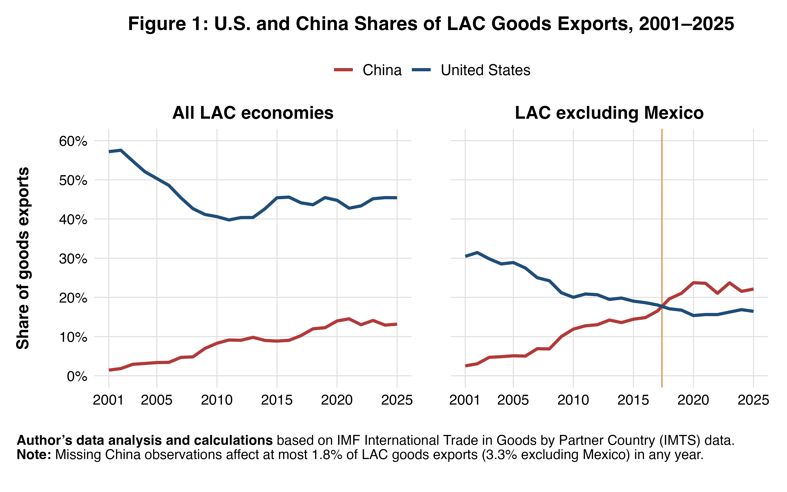
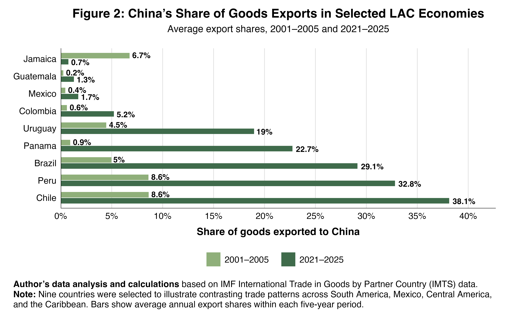

# Latin America and the Caribbean Trade Diversification Analysis

This project analyzes changes in the geography of merchandise exports across Latin America and the Caribbean (LAC), with a focus on the evolving roles of the United States and China.

Using annual IMF International Trade in Goods by Partner Country (IMTS) data for 2001–2025, the analysis examines regional export trends and differences in China's importance as an export destination across selected LAC economies.

## Analysis

The R script produces two figures:

**Figure 1: U.S. and China Shares of LAC Goods Exports, 2001–2025**  
Compares the evolution of U.S. and Chinese shares of merchandise exports for all LAC economies and for LAC excluding Mexico.

**Figure 2: China's Share of Goods Exports in Selected LAC Economies**  
Compares average export shares to China across nine selected economies during 2001–2005 and 2021–2025.

## Figures

### Figure 1

### Figure 2

## Data

Source: IMF International Trade in Goods by Partner Country (IMTS).

The analysis uses annual merchandise export data for 2001–2025. The raw IMF dataset is not included in this repository.

To reproduce the analysis, place the source CSV in:

`data_raw/imf_imts_lac_exports_annual_2001_2025_raw.csv`

## Tools

Analysis and visualization were completed in R using:

- dplyr
- tidyr
- readr
- ggplot2
- ggtext
